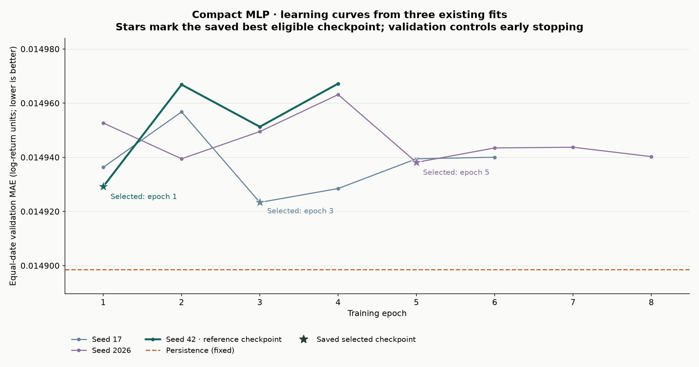
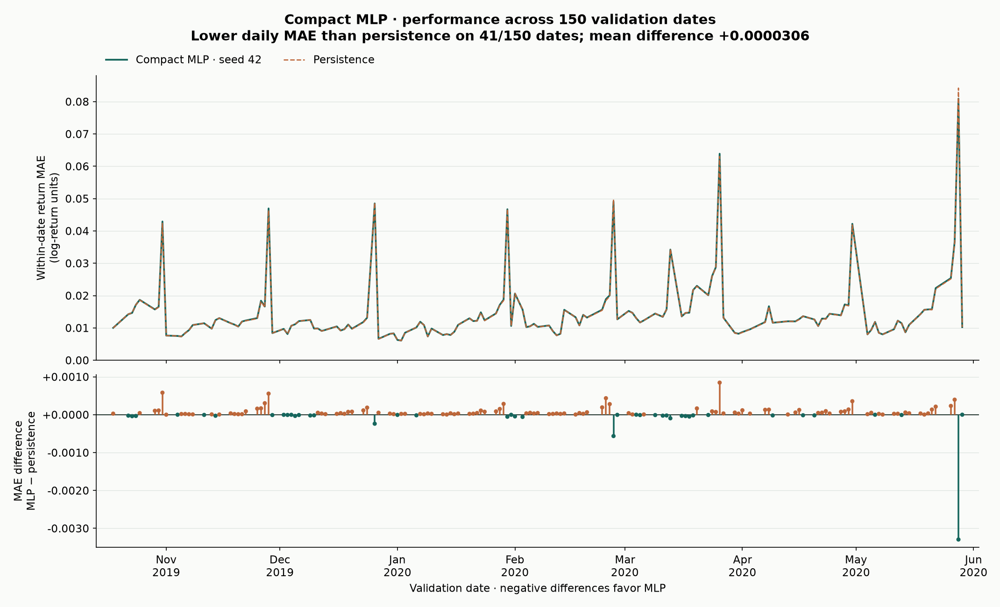
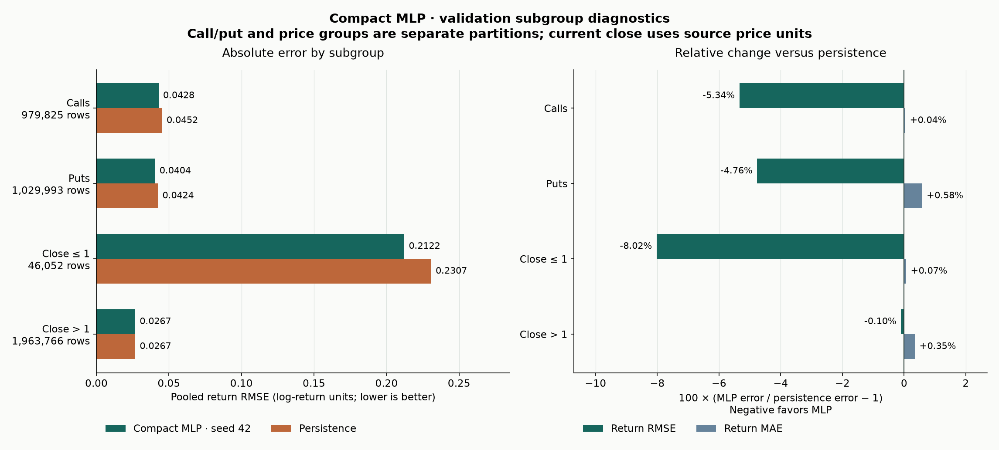

# Baseline model performance check-in

Prepared October 22, 2026. This follow-up evaluates the **previously selected compact MLP, seed 42**, using the completed, verified experiment. It introduces no new fit, tuning, architecture selection, or test-set evaluation.

## 1. Requirement audit and model application

| Check-in requirement | Status and evidence |
| --- | --- |
| Use the project data in last week's baseline | Already completed: full training data used in the `15→32→16→1` MLP; fixed seed-42 checkpoint retained |
| List metrics and useful diagnostic figures | Metrics already measured and verified; this report adds focused baseline learning, daily-error, and subgroup figures |
| Describe where the model works well and poorly | Existing subgroup evidence is organized below, separating absolute difficulty from improvement over persistence |

The model has **1,057 trainable parameters**, ReLU hidden activations, dropout 0.1, and a signed linear output. Its 15 features summarize six consecutive observed option bars. The target is `log(close[t+1] / close[t])`. Training used **7,069,922 examples** from 700 dates (2016-12-14–2019-10-17); validation used **2,009,818 examples** from 150 later dates (2019-10-18–2020-05-29).

Only training data updated model weights and fitted scalers. Validation guided early stopping and architecture selection, so these results are development estimates. The **2,389,879 reserved test examples were not evaluated**. Earlier EDA inspected all years; the test period was held out from fitting/tuning rather than unseen during exploration. The frozen checkpoint selected epoch 1, stopping after epoch 4. Its recorded fitting time was **28.5 seconds**, including validation and checkpoint work.

## 2. Performance metrics and inference time

This is regression, so classification “accuracy” is not an appropriate metric. Lower is better for every error metric. Return errors use log-return units; price errors use reported price units. Persistence predicts zero return, or no change in the next close. Price predictions are reconstructed as `close[t] * exp(predicted_return)`.

| Metric | Compact MLP, seed 42 | Persistence | Relative error change |
| --- | --- | --- | --- |
| Equal-date return MAE | 0.0149292 | 0.0148986 | +0.206% |
| Pooled return MAE | 0.0172119 | 0.0171599 | +0.303% |
| Pooled return RMSE | 0.0415746 | 0.0437919 | -5.063% |
| Price MAE | 1.7173575 | 1.7066798 | +0.626% |
| Price RMSE | 4.1198660 | 4.0712904 | +1.193% |

Positive relative changes mean worse error; negative changes mean improvement. Equal-date MAE averages the 150 daily MAEs equally; pooled MAE/RMSE weight every observation equally. The model improves return RMSE but does not improve overall absolute error or reconstructed-price accuracy.

All headline and subgroup results above refer to **one frozen checkpoint (seed 42)**. Separately, compact-architecture equal-date MAE across seeds 17, 42, and 2026 was **0.0149302 ± 0.0000074** (mean ± sample SD). Across dates for the frozen checkpoint, daily MAE was **0.0149292 ± 0.0105500**. Seed variability and variation across dates describe different things; neither is an independent final-test confidence interval.

Warm CPU batch-1 inference: **48.642 µs median**, **51.022 µs p95** over 500 measurements. A prepared batch of 4,096 took **0.436958 ms median** over 50 measurements. Both follow 20 warm-ups, using four CPU threads, PyTorch 2.2.2 on Darwin x86_64.

These timings include the forward pass and target rescaling, but exclude loading, feature preparation, tensor construction, and queuing. They do not measure total inference time for the entire validation dataset. The timing measurements are reused from the completed study; this check-in does not rerun the benchmark.

## 3. Useful diagnostic figures

**Learning curves:** validation date-MAE over epochs for the three compact-model seeds, with selected checkpoints marked. Early stopping keeps the selected checkpoint rather than the last epoch.



**Daily errors:** frozen MLP versus persistence and their difference across validation dates. Below-zero differences favor the MLP. It improves date-MAE on **41/150 dates** and worsens it on **109/150 dates**.



**Subgroup errors:** absolute return RMSE and relative MAE/RMSE changes across price bands and option types. These figures use existing predefined groups, not newly selected thresholds or synthetic noise labels.



## 4. Where the baseline worked well and poorly

| Subset | Rows | Return MAE | Return RMSE | MAE change | RMSE change |
| --- | --- | --- | --- | --- | --- |
| Calls | 979,825 | 0.018114 | 0.042821 | +0.038% | -5.340% |
| Puts | 1,029,993 | 0.016354 | 0.040353 | +0.583% | -4.764% |
| Current price ≤ 1 | 46,052 | 0.120366 | 0.212201 | +0.066% | -8.023% |
| Current price > 1 | 1,963,766 | 0.014793 | 0.026702 | +0.348% | -0.102% |

**Useful relative improvement:** return RMSE falls **5.06%** overall. For prices at or below one, RMSE falls **8.02%**; for prices above one, it falls only **0.10%**. The 46,052 low-price rows are **2.29%** of validation observations and account for **99.25%** of the squared-return-error reduction. This is a concentrated benefit on large return errors, not a broad gain in typical forecasts.

**Absolute difficulty:** low-price observations remain much harder in return units: RMSE **0.212201**, versus **0.026702** above one. Small absolute price changes can produce large log returns when the starting price is very low. Conversely, their absolute price errors can be small: return error and price error describe different behavior.

**Option type:** puts have lower absolute return MAE than calls, but both have slightly higher MAE than their own persistence comparator. This does not establish that the model adds more value for puts. Counts and relative changes are shown in the table.

**Weaknesses:** pooled MAE increases **0.303%**, equal-date MAE increases **0.206%**, and price MAE/RMSE increase **0.626%/1.193%**. The model beats persistence on only 41 of 150 dates. Its best absolute daily MAE is **0.0060800** on **2020-01-02**, while its worst is **0.0808938** on **2020-05-28**. A hard date can still show an improvement over persistence; absolute error and relative value should not be confused.

**Insufficient evidence:** there are only **2 zero-volume validation observations**, so no reliable zero-volume performance claim is possible. The raw dataset's many zero-volume bars do not imply a large eligible validation subgroup. We have not introduced “clean/noisy” labels because this financial dataset has no validated noise-type annotation.

The baseline is a useful small neural reference, but it has not demonstrated an overall forecasting advantage. These bar-price errors do not establish trading profitability. Keep the model frozen for comparisons; investigate the causes of return/price-metric disagreement before spending more compute on larger networks.

## 5. Evidence and reproducibility

The builder checks hashes of all eight saved evidence tables/configurations against the [completed study verification](../nifty_mlp_study/verification.json), confirms the frozen model matches the verified seed-42 checkpoint, and independently reconstructs all five headline metrics from the daily table. It reads no train/test arrays, performs no fitting, and does not alter the earlier reports. The original verifier reproduced all 24 model checkpoints' validation predictions, including this baseline.

```bash
MPLCONFIGDIR=/private/tmp/nifty-mlp-matplotlib .conda/bin/python scripts/build_nifty_baseline_performance.py
```

Sources: [model runs](../nifty_mlp_study/runs.csv), [subgroup metrics](../nifty_mlp_study/subgroups.csv), [inference measurements](../nifty_mlp_study/inference.csv), and [daily comparison](daily_comparison.csv). The new [summary and evidence hashes](summary.json) preserve the provenance of this presentation. The [architecture report](../nifty_mlp_study/report.md) remains the full eight-model comparison.

## 6. Short answers to the check-in questions

1. We applied the selected `15→32→16→1` MLP to 7,069,922 training examples and evaluated its frozen seed-42 checkpoint on 2,009,818 validation examples. The final test set remains reserved.
2. Validation return MAE was **0.01721**, RMSE **0.04157**, and equal-date MAE **0.0149292**; price MAE/RMSE were **1.717/4.120**. Warm CPU inference took approximately **49 µs per example**. Diagnostic figures show learning curves, daily errors, and subgroup comparisons.
3. Return RMSE improved **5.06%** over persistence, especially for low-price options (**8.02%** improvement). However, low-price options still had much higher absolute RMSE (**0.2122** versus **0.0267** above one price unit). Overall MAE and price errors were slightly worse, so the model has not demonstrated an overall forecasting advantage.
