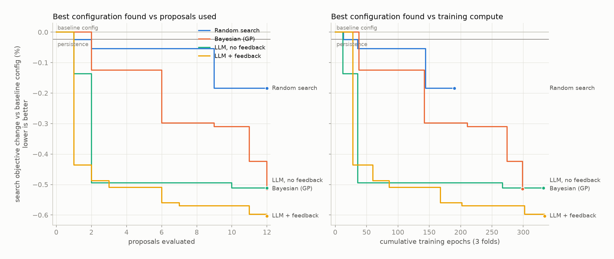
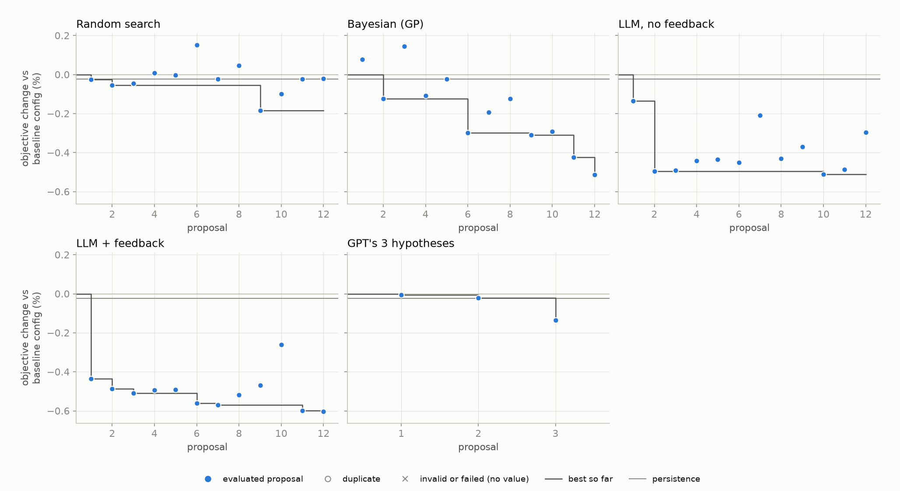
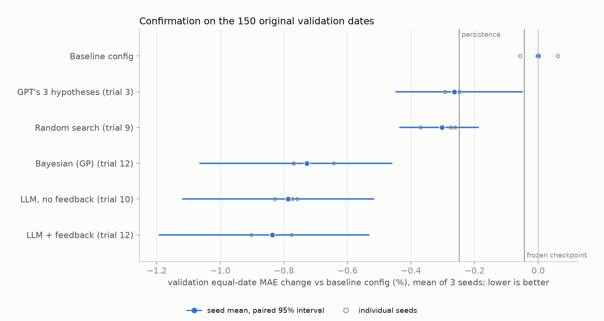

# LLM-guided improvement search for the compact Nifty MLP

Interpretation, limitations and next steps: [findings](findings.md).

Built 2026-11-02 from saved files; this builder trains nothing. Study protocol written 2026-11-02 before any search training. **The reserved June–December 2020 test dates have not been evaluated.**

**Status:** Random search 12/12, Bayesian (GP) 12/12, LLM, no feedback 12/12, LLM + feedback 12/12, GPT's 3 hypotheses 3/3. Confirmation: complete.

## Question and design

> Can an LLM use model diagnostics to find improvements to the fixed compact MLP more efficiently than conventional tuning, under the same experiment budget?

Every search proposes complete settings for the fixed `15→32→16→1` MLP from the same eight-parameter space (loss, Smooth L1 beta, learning rate, weight decay, dropout, date weighting, low-price weighting, output calibration). Each proposal is trained on three expanding forward folds inside the original training dates and scored by the mean equal-date MAE of the folds' score windows. Training uses only fit dates; tune dates drive early stopping and calibration. Every search has a budget of **12 proposals**; invalid proposals and duplicates use budget. The LLM receives a written brief of the task, rules, baseline diagnostics and earlier findings; it never sees rows, labels or test-period information, and Python computes every number.

| Search | How proposals are made |
|---|---|
| Random search | Uniform random search over the shared space |
| Bayesian (GP) | Optuna Gaussian-process Bayesian optimization (GPSampler; 3 random starts after the shared baseline) |
| LLM, no feedback | LLM proposes every configuration at once from the diagnostic brief, without feedback |
| LLM + feedback | LLM proposes one configuration at a time and receives measured diagnostic feedback |
| GPT's 3 hypotheses | GPT's three predeclared first hypotheses, one change each from the baseline (3 fixed trials) |

Before any search, the new runner reproduced the frozen checkpoint's weights and validation predictions bit for bit (confirmed). The baseline configuration scored **0.0144484** on the search folds; persistence scored **0.0144451** (-0.023% vs the baseline config).

## Search results

| Search | Done | Best trial | Best objective change | Mean best-so-far | Evaluated / duplicate / invalid / failed | Training epochs | Training time |
|---|---|---|---|---|---|---|---|
| Random search | 12/12 | 9 | -0.184% | -0.095% | 12 / 0 / 0 / 0 | 190 | 12.9 min |
| Bayesian (GP) | 12/12 | 12 | -0.514% | -0.246% | 12 / 0 / 0 / 0 | 299 | 16.3 min |
| LLM, no feedback | 12/12 | 10 | -0.512% | -0.469% | 12 / 0 / 0 / 0 | 332 | 37.5 min |
| LLM + feedback | 12/12 | 12 | -0.603% | -0.541% | 12 / 0 / 0 / 0 | 334 | 33.4 min |
| GPT's 3 hypotheses | 3/3 | 3 | -0.136% | -0.054% | 3 / 0 / 0 / 0 | 41 | 2.2 min |

Objective changes are relative to the baseline configuration on the same folds (negative is better). *Mean best-so-far* averages, over proposals 1 to the budget, the best change found so far (the baseline counts as already known, so it never exceeds 0%); it rewards finding improvements early. Training time is charged per proposal even when an identical configuration was cached by another search; epochs are the hardware-independent cost unit because searches may have run concurrently.





### Selected configurations

| Search | Trial | Changes from baseline | Objective change | Hypothesis (LLM/GPT) |
|---|---|---|---|---|
| Random search | 9 | smooth_l1_beta=0.328, learning_rate=0.000546, weight_decay=0.000141, dropout=0.0692, sample_weighting=date_balanced, low_price_weight=0.844 | -0.184% | - |
| Bayesian (GP) | 12 | loss=l1, learning_rate=0.00115, weight_decay=0.1, dropout=0, sample_weighting=date_balanced, calibration=global_scale | -0.514% | - |
| LLM, no feedback | 10 | loss=l1, weight_decay=0.1, dropout=0, sample_weighting=date_balanced, calibration=price_group_scale | -0.512% | Baseline tune MAE degraded after epoch 1 while training MAE improved, a sign of fitting fit-window-specific structure. Decoupled weight decay 0.1 at lr 0.001 shrinks weights by about 10-13% per epoch, pruning weakly supported weights and pulling forecasts toward persistence, which should transfer better to later dates. |
| LLM + feedback | 12 | loss=l1, learning_rate=0.003, dropout=0, sample_weighting=date_balanced, calibration=global_scale | -0.603% | Trial 11 (lr 0.003) is the best configuration, and its outputs look slightly over-sized on new dates, mainly for close > 1 rows. Its mean /prediction/ / mean /target/ of 0.074 is the largest of any L1 trial (0.029-0.072 otherwise). Close > 1 RMSE is still 0.16% above persistence and price RMSE is +0.16/+0.01/+0.19%, while close > 1 MAE gains only 0.12%. The metric charges excess size at first order where the conditional median is zero (15.4% exact zeros for close > 1, median /y/ 0.066 std). Fold 1 selected its epoch-2 model, trained only at the full rate; in trial 8, calibration raised the tune scores of the full-rate fold-1 epochs 1 and 2 by 0.12 and 0.08 points. Wherever a tune-fitted multiplier left the selected model unchanged, it also improved the score. Trial 4 fold 1 (epoch 4 in both runs) went from -0.58 to -0.60%, with dates better than persistence 57 -> 64 and price RMSE +0.13 -> +0.04%. Trial 8 fold 3 (epoch 7 in both) went from -0.43 to -0.44%, with price RMSE +0.22 -> +0.15%. Both price_group_scale trials lost overall only through stopping and epoch selection, because the calibrated tune curve favored early, noisy epochs. Trial 4 fold 3 stopped at epoch 5 with its epoch-2 model (-0.31 vs -0.35%), and trial 8 fold 1 stopped at epoch 4 with its epoch-1 model and a close > 1 alpha of 0.24 (-0.48 vs -0.53%, 14/80 dates). Calibration did not visibly alter the training path. Training-sample MAE sequences were identical in trials 3 and 4 in every fold, even where the two tune curves disagreed about a new best (fold 2 epoch 6: -0.34% uncalibrated, no new best; -0.38% calibrated, a new best), and in trials 7 and 8 for the first 3, 10 and 10 epochs. global_scale, the one calibration mode not yet tested, fits a single alpha that must also scale the close <= 1 reversal predictions. Their own alphas were 0.90-1.00, and they supply about 85% of the MAE gain (0.154 x 3.72% = 0.57 of the 0.67-point mean pooled gain). The single alpha should therefore stay well above the close > 1 values (0.24-0.91), cannot remove the close > 1 outputs as in trial 8 fold 1, and gives noisy early epochs smaller boosts. Trial 11's selections should then hold. Fold 1 epoch 2 leads epoch 1 by 0.06 points; epoch 5 ties it but was trained at a quarter of the rate, so it should gain less from shrinkage. Fold 2 epoch 11 leads epoch 8 by 0.05, and fold 3 epoch 12 leads epoch 9 by 0.08. The result should be trial 11's models shrunk by an alpha of about 0.85-0.97, with a small gain in every fold, largest in fold 1. |
| GPT's 3 hypotheses | 3 | calibration=price_group_scale | -0.136% | Almost all squared-error improvement comes from options priced at or below one, so the two price groups need separate calibration coefficients. |

## LLM behaviour and cost

| Search | Model(s) | Prompts (repairs) | Prompt / reply characters | Estimated tokens | Median relay time | Predicted vs measured change |
|---|---|---|---|---|---|---|
| LLM, no feedback | Claude Opus 5.5 (fresh Claude Code subagent) | 1 (0) | 8,824 / 12,940 | 5,441 | 1228.2 min | Spearman +0.61; direction right 100% |
| LLM + feedback | Claude Opus 5.5 (fresh Claude Code subagent) | 12 (0) | 379,244 / 47,838 | 106,770 | 9.0 min | Spearman +0.41; direction right 100% |

Tokens are estimated as characters / 4. Relay time runs from prompt creation to reply submission and includes the person relaying the text, so it is not model latency. *Direction right* is the share of evaluated proposals whose predicted and measured changes had the same sign.

## Confirmation on the original validation dates

Each search's selected configuration and the baseline configuration were refit with seeds 17, 42, 2026: fit on 2016-12-14 to 2019-08-16 (training dates 0-659); tuned on 2019-08-19 to 2019-10-17 (training dates 660-699); scored on the 150 original validation dates (2019-10-18 to 2020-05-29).

| Selection | Trial | Equal-date MAE (3-seed mean) | vs baseline config [paired 95%] | vs persistence | RMSE vs persistence | Price MAE vs persistence | Dates better than persistence |
|---|---|---|---|---|---|---|---|
| Baseline config | - | 0.0149357 | +0.000% | +0.249% | -5.74% | +0.54% | 32/150 |
| GPT's 3 hypotheses | 3 | 0.0148964 | -0.264% [-0.447, -0.050] | -0.015% | -1.25% | +0.00% | 19/150 |
| Random search | 9 | 0.0148906 | -0.302% [-0.435, -0.189] | -0.053% | -4.36% | +0.30% | 69/150 |
| Bayesian (GP) | 12 | 0.0148271 | -0.728% [-1.064, -0.460] | -0.480% | -3.27% | +0.60% | 101/150 |
| LLM, no feedback | 10 | 0.0148182 | -0.787% [-1.118, -0.517] | -0.539% | -3.17% | +0.31% | 106/150 |
| LLM + feedback | 12 | 0.0148108 | -0.836% [-1.192, -0.533] | -0.589% | -3.44% | -0.15% | 111/150 |

Persistence equal-date MAE: 0.0148986. The unchanged frozen checkpoint scores 0.0149292 but was early-stopped on these dates, so it is a reference rather than a fair comparator. Intervals come from a circular block bootstrap over dates (block 5) of seed-averaged daily differences; they describe variation across these dates, not uncertainty over future markets.



## Caveats

- The loss choice l1 lies inside the space, so random sampling reaches it with probability 1/3 per draw; the LLM's value may appear as efficiency rather than discovery.
- One search per arm is a pilot: it cannot separate method quality from search luck.
- Search uses one training seed. The compact baseline's seed SD of validation equal-date MAE was 0.0000074 (about 0.05%), so smaller differences are within optimization noise.
- The original validation dates already guided architecture selection and are summarized in the LLM brief, so confirmation there remains a development estimate.
- Manual relay latency includes human time and is not a model-latency measurement.

## Reproduce

```bash
.conda/bin/python scripts/run_nifty_llm_search.py --init
for arm in gpt_hypotheses random bayes; do .conda/bin/python scripts/run_nifty_llm_search.py --arm $arm; done
.conda/bin/python scripts/run_nifty_llm_search.py --arm llm_feedback --wait   # relay prompts meanwhile
.conda/bin/python scripts/nifty_llm_handoff.py status
.conda/bin/python scripts/confirm_nifty_llm_search.py
.conda/bin/python scripts/build_nifty_llm_search_report.py
```

Inputs: [protocol](protocol.json), [brief shown to the LLM](brief.md), per-search trial logs in `trials/`, per-configuration fold results in `results/`, and every prompt and reply in `handoff/`.
How the prompts were answered, and deviations from the relay protocol: [llm_relay.md](llm_relay.md).

