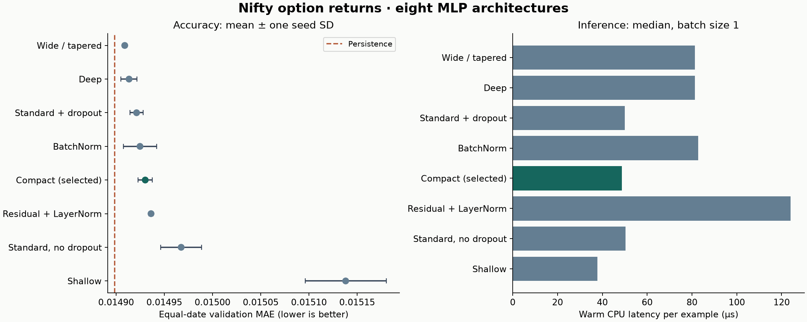
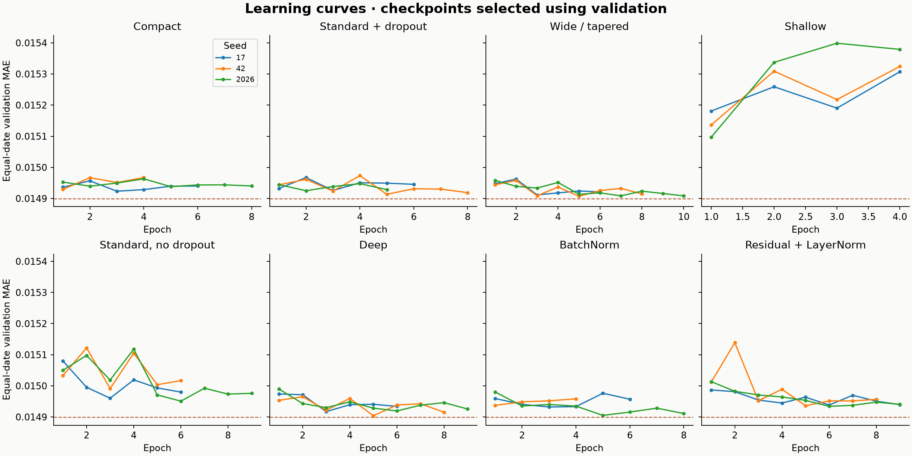

# Nifty options: MLP baseline architecture comparison

**Weekly check-in · October 22, 2026 · Completed experiment**

We compared **eight MLP architectures across three seeds each** using the same
15 prepared features and chronological split. Fifteen fits are new; nine are
verified results from the October 14 study. **Wide / tapered has the lowest mean
validation date-MAE among the MLPs (0.0149090).**
The predeclared complexity rule selects **Compact**, with
1,057 parameters, because its mean is only
0.142% above the best neural mean. Persistence has date-MAE
0.0148986; the best MLP's error is
0.070% higher.
These are development-set results; the final test partition was not evaluated.

## 1. How last week's data exploration informs the models

The EDA audited 17,611,169 selected rows. Preprocessing retained 17,576,228 clean
bars and produced 11,469,619 supervised examples. Prices and volumes are skewed;
the retained data include 374,544 zero-volume bars, 490,741 prices at or below
one price unit, and 3,345,913 flat OHLC bars. Missing minutes are common and are
not filled. The unverified ninth field and inferred expiry dates are excluded.
See the existing [EDA summary](../nifty_eda/summary.json) and
[preprocessing summary](../nifty_preprocessing/summary.json).

The task is **next-minute option log-return forecasting**:
`y = log(close[t+1] / close[t])`. Each observation uses six consecutive bars
ending at `t`, and the target must occur exactly one minute later within the
same source file and date. Inputs are **15 engineered tabular features**, not
a `6 × 15` raw sequence: logged price/strike/volume, range and candle change,
one- and five-minute returns, recent volatility and volume, cyclical time, and
call/put, zero-volume, low-price, and flat-bar indicators. Nine continuous
features use training-only standardization; the others retain their encoding.

This representation supports small MLPs directly. Correlated windows and
options reduce the effective sample size, motivating dropout and compact
capacity despite millions of rows. Extreme returns motivate a robust training
loss and reporting both absolute and squared errors. Sparse and low-price
observations motivate subgroup checks. The dataset lacks verified complete
contract identities, expiry inputs, synchronized underlying prices, and
executable quotes; this experiment does not measure theoretical pricing error
or trading profitability.

| Partition | Dates | Observed dates | Examples | Use |
| --- | --- | --- | --- | --- |
| Train | 2016-12-14–2019-10-17 | 700 | 7,069,922 | Fit parameters and scalers |
| Validation | 2019-10-18–2020-05-29 | 150 | 2,009,818 | Early stopping and architecture comparison |
| Reserved test | 2020-06-01–2020-12-31 | 150 | 2,389,879 | No model evaluation in this study |

The split is chronological by date, not random by row. Earlier EDA examined
all periods, so the test period is held out from model development rather than
unseen during exploration. This extension also reuses the earlier validation
period and therefore adds selection exposure.

## 2. Baselines and literature-backed architecture choices

**Persistence** predicts zero return, equivalent to the next close equaling
the current close. **Ridge regression** is a linear comparator using the same
features; its penalty is selected from 0.0001, 0.01, and 1.0. The **compact MLP**
is the established neural baseline against which the other MLPs are compared.

Plain MLP and residual tabular networks are established comparison families in
[Gorishniy et al. (2021)](https://arxiv.org/html/2106.11959v5). We test ordinary
ReLU networks at different depths and widths, a matched dropout comparison,
BatchNorm, and an adapted residual network. The exact widths below are project
choices; they are not claims to reproduce published tuned architectures.

| MLP | Structure | Regularization / normalization | Evidence origin |
| --- | --- | --- | --- |
| Compact | 15 → 32 → 16 → 1 | Dropout 0.1 | Prior: 3 verified fits |
| Standard + dropout | 15 → 64 → 32 → 1 | Dropout 0.1 | Prior: 3 verified fits |
| Wide / tapered | 15 → 128 → 64 → 32 → 1 | Dropout 0.1 | Prior: 3 verified fits |
| Shallow | 15 → 64 → 1 | Dropout 0.1 | New: 3 fits |
| Standard, no dropout | 15 → 64 → 32 → 1 | No dropout | New: 3 fits |
| Deep | 15 → 64 → 64 → 64 → 64 → 1 | Dropout 0.1 | New: 3 fits |
| BatchNorm | 15 → 64 → 32 → 1 + BatchNorm | Dropout 0.1 + BatchNorm | New: 3 fits |
| Residual + LayerNorm | 15 → 64; 2 × residual blocks at width 64; → 1 | Dropout 0.1 + LayerNorm + skips | New: 3 fits |

All heads are unconstrained linear scalars, allowing positive and negative
returns. Ordinary hidden blocks are `Linear → ReLU → Dropout`; BatchNorm is
inserted between Linear and ReLU. The residual model has a `15 → 64` ReLU stem
and two blocks computing
`ReLU(h + Linear(Dropout(ReLU(Linear(LayerNorm(h))))))`, followed by a scalar
head. Each block contains two width-64 dense layers. This LayerNorm design
adapts the residual family; the cited tabular ResNet uses BatchNorm instead.

Dropout is motivated by [Srivastava et al. (2014)](https://jmlr.org/papers/v15/srivastava14a.html);
normalization choices by [Ioffe and Szegedy (2015)](https://proceedings.mlr.press/v37/ioffe15.html)
and [Ba et al. (2016)](https://arxiv.org/abs/1607.06450).
The standard/plain pair holds dense widths fixed while adding dropout.
The standard/BatchNorm pair adds normalization at the same widths. Other
comparisons change several architectural properties and parameter counts.
The [literature companion](literature.md) explains expected performance and
cost tradeoffs and provides eight primary references verified online.

## 3. Controlled training and selection

- Full training and validation arrays for every model; no downsampled results.
- Seeds **17, 42, 2026**, batch size **4,096**, AdamW learning rate **0.001**,
  weight decay **0.0001**, gradient norm clipping **1.0**.
- Smooth L1 loss (`beta=1`) on returns divided by their training-only standard
  deviation **0.0798147523**, without centering or clipping.
- At most **12 epochs**; stop after three epochs without date-MAE improvement
  of at least `1e-6`. Halve learning rate on a validation plateau, with patience
  one and minimum learning rate `1e-5`. Restore the best eligible checkpoint.
- Default PyTorch hidden initialization and zero output weights/bias, giving
  a persistence prediction before training. All training rows are shuffled
  within the training partition each epoch.
- **Primary metric:** compute MAE on each validation date, then average equally
  across dates. Secondary metrics pool rows: return MAE/RMSE and reconstructed
  price MAE/RMSE, where `predicted_price = close[t] * exp(predicted_return)`.
- **Selection:** smallest parameter count within **0.5%** of the lowest
  three-seed mean date-MAE; predeclared seed **42** is the reference checkpoint.

The [protocol](protocol.json) was saved before fitting and fixes these choices.
The old nine runs are reused only after validating their artifact and input
hashes; their provenance remains visible in [runs.csv](runs.csv). This avoids
claiming they were trained again. The extension leaves the prior study and
its frozen checkpoint unchanged. Interrupted work is resumed only after
checking saved run hashes; a partially completed seed is restarted.

This is a common-recipe comparison, not a separately optimized hyperparameter
search for every family. Training loss weights rows equally, whereas selection
weights dates equally. Ridge uses squared loss, so ridge-versus-MLP results
compare complete pipelines rather than isolating architecture alone.

## 4. Measured validation accuracy

All neural table entries are means across the three runs; **± SD** is the sample
standard deviation across seeds for date-MAE. It measures optimization
variability, not uncertainty about future market conditions. Return errors are
in log-return units; price errors use the source's reported price units.
Lower is better for every metric.

| MLP | Parameters | Date MAE, mean ± SD | Pooled MAE | Pooled RMSE | Price MAE | Price RMSE |
| --- | --- | --- | --- | --- | --- | --- |
| Compact | 1,057 | 0.0149302 ± 0.0000074 | 0.0172067 | 0.0412959 | 1.7120 | 4.0983 |
| Standard + dropout | 3,137 | 0.0149213 ± 0.0000069 | 0.0171939 | 0.0412289 | 1.7097 | 4.0871 |
| Wide / tapered | 12,417 | 0.0149090 ± 0.0000022 | 0.0171732 | 0.0409861 | 1.7095 | 4.0772 |
| Shallow | 1,089 | 0.0151381 ± 0.0000421 | 0.0174996 | 0.0414740 | 1.9039 | 4.9516 |
| Standard, no dropout | 3,137 | 0.0149675 ± 0.0000213 | 0.0172598 | 0.0412411 | 1.7391 | 4.2233 |
| Deep | 13,569 | 0.0149135 ± 0.0000083 | 0.0171778 | 0.0410146 | 1.7074 | 4.0688 |
| BatchNorm | 3,329 | 0.0149248 ± 0.0000174 | 0.0171950 | 0.0411026 | 1.7233 | 4.1577 |
| Residual + LayerNorm | 17,985 | 0.0149363 ± 0.0000021 | 0.0172137 | 0.0413424 | 1.7162 | 4.1464 |

Non-neural comparators from the verified prior full-data study:

| Comparator | Date MAE | Pooled MAE | Pooled RMSE | Price MAE | Price RMSE |
| --- | --- | --- | --- | --- | --- |
| persistence | 0.0148986 | 0.0171599 | 0.0437919 | 1.7067 | 4.0713 |
| ridge_0.0001 | 0.0168792 | 0.0193828 | 0.0433018 | 1.9737 | 4.7690 |
| ridge_0.01 | 0.0168474 | 0.0193484 | 0.0432714 | 1.9682 | 4.7567 |
| ridge_1 | 0.0155933 | 0.0179485 | 0.0420814 | 1.7978 | 4.3388 |



**Accuracy versus complexity.** The selected Compact has mean date-MAE
0.0149302, a +0.213% change
versus persistence (positive means worse). Its mean pooled return RMSE improves
by 5.70%, while price MAE changes by +0.312%.
Different metrics therefore need separate interpretation. The tolerance rule
chooses a practical neural benchmark; it is not a significance test and does
not require a neural model to beat persistence.
Smooth L1 is not the MAE selection objective: better performance on large
return errors can coexist with worse typical absolute or price errors.

**Dropout at fixed widths.** Adding dropout 0.1 to `64 → 32` changes mean
date-MAE by **-0.309%** relative to the no-dropout model.
**BatchNorm at fixed widths.** Adding BatchNorm to the dropout model changes
mean date-MAE by **+0.024%**. Positive changes mean higher error.
[Paired seed differences](paired_comparisons.csv) preserve the individual
comparisons; three seeds are insufficient for a broad claim about superiority.

**Depth and width.** Shallow, compact, wide, deep, and residual results test
useful practical structures, but capacity and optimization change together.
Despite similar parameter counts (1,089 versus 1,057), the shallow model's
mean date-MAE changes by **+1.392%** relative to compact.
The four-hidden-layer model changes date-MAE by **+0.030%** relative
to the tapered wide model (13,569 versus 12,417 parameters). The residual model
changes it by **+0.183%** relative to wide, using 17,985 parameters.
These are measured common-recipe comparisons, not claims about all possible
widths or tuning budgets. A network's additional operations are justified only
if the observed accuracy benefit merits the cost in the next table.

Deep has the lowest neural mean price MAE and price RMSE in this study. Its
price RMSE changes by **-0.0615%** versus persistence,
while its date-MAE and price MAE remain worse. This small secondary-metric gain
does not change the predeclared date-MAE selection.



The plot shows all completed epochs, including epochs after the selected
checkpoint. These curves and [history.csv](history.csv) document early stopping;
an early best epoch is possible even when training loss continues improving.

## 5. Compute and measured inference time

All fits ran on CPU. The recorded environment is Darwin
x86_64, 16 logical CPUs,
**four PyTorch/BLAS threads**, PyTorch 2.2.2,
NumPy 1.26.4, and pandas 2.3.3.
Reported training durations include epoch validation, training probes, final
prediction, and checkpoint saving; they exclude initial input verification.
The new 15 completed fits total **17.2
minutes** of recorded run time, excluding abandoned partial work and setup.

| MLP | Dense MACs / row | Mean epochs | Mean fit seconds | Batch-1 median µs | Batch-1 p95 µs | Batch-4096 median ms |
| --- | --- | --- | --- | --- | --- | --- |
| Compact | 1,008 | 6.0 | 42.4 (prior) | 48.6 | 51.0 | 0.437 |
| Standard + dropout | 3,040 | 6.3 | 55.0 (prior) | 50.1 | 94.8 | 0.298 |
| Wide / tapered | 12,192 | 8.0 | 142.9 (prior) | 81.3 | 137.6 | 2.118 |
| Shallow | 1,024 | 4.0 | 17.8 (new) | 37.8 | 78.8 | 0.120 |
| Standard, no dropout | 3,040 | 7.0 | 37.8 (new) | 50.3 | 88.0 | 0.424 |
| Deep | 13,312 | 7.7 | 102.6 (new) | 81.3 | 164.9 | 0.482 |
| BatchNorm | 3,040 | 6.0 | 56.6 (new) | 82.8 | 98.0 | 0.848 |
| Residual + LayerNorm | 17,408 | 8.7 | 129.6 (new) | 124.0 | 236.1 | 1.007 |

Training times marked **prior** were recorded in the earlier session; **new**
times were recorded in this extension. Shared hardware/software settings help
comparability, but system load and early-stopping epochs differ, so these are
not controlled training-speed ratios. Inference was measured afresh for all
eight architectures together: 20 warm-ups, 500 repeats at batch 1, and 50 repeats
at batch 4,096, using the seed-42 checkpoints in evaluation mode.

Inference timings include the forward pass and rescaling to return units;
they exclude data loading, tensor construction, preprocessing, and queuing.
They are warm local latency measurements, not end-to-end service guarantees.
Dropout is inactive during inference; BatchNorm uses training-fitted running
statistics. LayerNorm normalizes each example. Dense MAC estimates count
matrix multiply-accumulates only, excluding nonlinearities and normalization.
Float32 parameter storage ranges from roughly 4 to 70 KiB, excluding buffers,
optimizer state, and activations; fitting the full dataset is the larger cost.

## 6. Dates, low-price options, and uncertainty

For the selected model and lowest-mean-error model, we compare predeclared
seed-42 checkpoints with persistence on individual dates:

- **Compact, seed 42:** date-MAE difference versus persistence +0.0000306; descriptive 95% interval [-0.0000208, +0.0000699]; better on 41 of 150 validation dates.
- **Wide / tapered, seed 42:** date-MAE difference versus persistence +0.0000085; descriptive 95% interval [-0.0000389, +0.0000438]; better on 47 of 150 validation dates.

These intervals use 2,000 circular moving-block resamples of validation dates,
block length five, seed 8801. They are descriptive **after selection on the same
validation period**, not independent test confidence intervals. Nonstationary
market regimes can invalidate the block assumptions. Daily metrics for every
MLP's seed-42 checkpoint are saved in [daily_validation.csv](daily_validation.csv).

| Subset | Model, seed 42 | Rows | Date MAE | Pooled RMSE | Price MAE |
| --- | --- | --- | --- | --- | --- |
| close_at_most_1 | Persistence | 46,052 | 0.0643837 | 0.2307111 | 0.0310 |
| close_above_1 | Persistence | 1,963,766 | 0.0132458 | 0.0267295 | 1.7460 |
| close_at_most_1 | Compact | 46,052 | 0.0653224 | 0.2122006 | 0.0315 |
| close_above_1 | Compact | 1,963,766 | 0.0132842 | 0.0267023 | 1.7569 |
| close_at_most_1 | Wide / tapered | 46,052 | 0.0657565 | 0.2094335 | 0.0315 |
| close_above_1 | Wide / tapered | 1,963,766 | 0.0132723 | 0.0265173 | 1.7479 |

Low option prices can turn a small absolute price change into a large log
return. The selected model's seed-42 return RMSE changes by **-8.02%**
versus persistence for prices at or below one, and **-0.10%**
above one. Comparing both subsets helps determine whether pooled return RMSE
is dominated by cheap options. Low-price rows are **2.29%** of
validation observations but contribute **63.60%** of persistence's
squared return error and **99.25%** of the selected seed-42
model's squared-error reduction. The overall RMSE gain is therefore concentrated
in cheap options. The zero-volume validation subset contains only
**2 observations** and cannot support a meaningful volume-regime
conclusion. Additional call/put and zero/positive-volume
diagnostics are in [subgroups.csv](subgroups.csv). Subgroup results above refer
to seed 42, while the architecture table averages three seeds; they should not
be conflated.

## 7. Other deep learning techniques and the next experiment

The following techniques were researched but **not trained in this study**.
Their performance and timing on Nifty remain unmeasured.

| Technique | Expected value to test | Compute and inference implications |
| --- | --- | --- |
| LSTM | Learn temporal order that six-bar summaries discard; no guaranteed accuracy gain | Requires causal per-bar sequence inputs; recurrent time steps introduce sequential work |
| Causal TCN | Learn short local patterns and a chosen receptive field using temporal convolutions | Requires sequence inputs; convolutions parallelize positions, with cost set by channels, kernels, and depth |
| FT-Transformer | Learn interactions among the existing tabular features through feature tokens | Can use the current features; embeddings and attention add work, with quadratic attention interactions in token count |

These proposals follow [Hochreiter and Schmidhuber (1997)](https://doi.org/10.1162/neco.1997.9.8.1735),
[Bai et al. (2018)](https://arxiv.org/abs/1803.01271), and
[Gorishniy et al. (2021)](https://arxiv.org/html/2106.11959v5).
The original [Transformer paper](https://arxiv.org/html/1706.03762v7) explains
attention's token-count cost and parallelism. With short windows or few feature
tokens, measured overhead and hidden width also matter. Published rankings
on other datasets do not predict the ranking on these option returns.

For the next check-in, retain persistence and the selected compact neural
benchmark, improve the causal sequence representation before adding an
LSTM/TCN, and use validation-only date/regime checks. A later final comparison
should freeze choices first and evaluate the reserved test partition once.
No claim of profitable trading follows from the current error metrics.

## 8. Reproducibility and verification

From the repository root:

```bash
# Start the extension when its output directory has no existing protocol.
.conda/bin/python scripts/train_nifty_mlp_study.py
# Continue an interrupted extension while preserving completed fits.
.conda/bin/python scripts/resume_nifty_mlp_study.py
# Independently reproduce predictions and metrics; then rebuild this report.
.conda/bin/python scripts/verify_nifty_mlp_study.py
.conda/bin/python scripts/build_nifty_mlp_report.py
.conda/bin/python -m pytest -q
```

The runner protects existing study outputs. To intentionally start a new full
study, first archive both `reports/nifty_mlp_study/` and
`data/processed/nifty_mlp_study/`; preserve the literature companion for report
navigation. Model weights and full validation predictions are Git-ignored
local artifacts. Small results and reports remain versionable.

The independent [verification record](verification.json) checks the 24
checkpoint reloads against saved predictions, the five metrics per run,
parameter counts, seeds, source/input hashes, early-stopping choices,
aggregation, and the selection rule. Synthetic tests cover signed outputs,
checkpoint restoration, inference determinism, BatchNorm statistics, residual
gradients, and learning on a known small nonlinear relationship. The report
builder reads saved tables and does not fit models or access test data.

Key files: [protocol.json](protocol.json), [runs.csv](runs.csv),
[architecture_comparison.csv](architecture_comparison.csv),
[inference.csv](inference.csv), [diagnostics.json](diagnostics.json),
[literature.md](literature.md), and the [short check-in answer](check_in.md).

## 9. Short check-in answer

Based on last week's exploration, we used 15 cleaned features to predict next-minute Nifty option log returns. We compared eight MLP architectures—including shallow, deeper, dropout, BatchNorm, and residual networks—across three seeds, with persistence and ridge as reference baselines. The wide MLP achieved the lowest neural validation date-MAE (0.0149090), while our size-versus-accuracy rule selected the compact MLP (1,057 parameters; approximately 49 µs warm CPU inference per example). The best MLP's mean date-MAE was 0.07% higher than persistence. We will retain this small neural benchmark and investigate sequence models next; these are validation findings, with final test evaluation still reserved.
