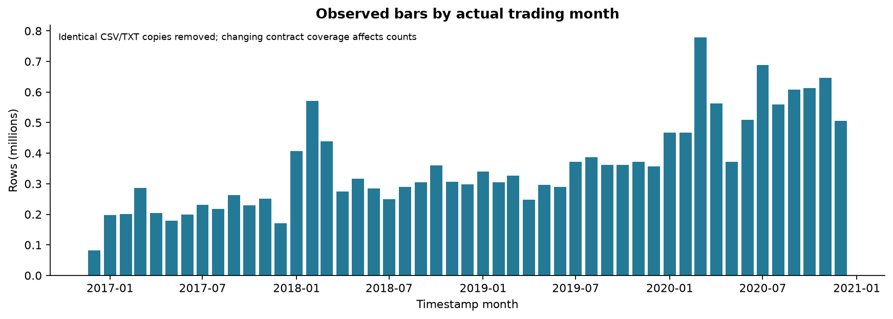
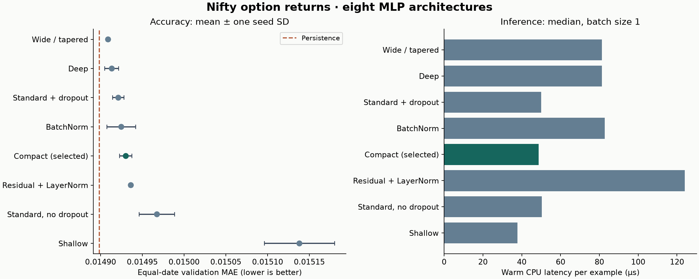
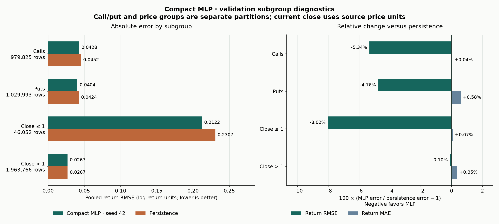
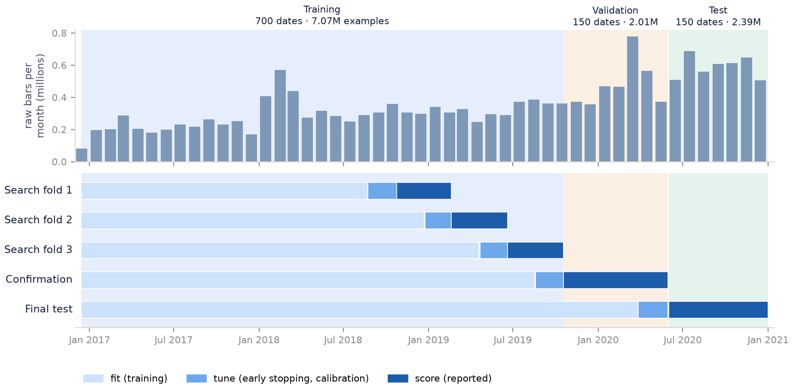
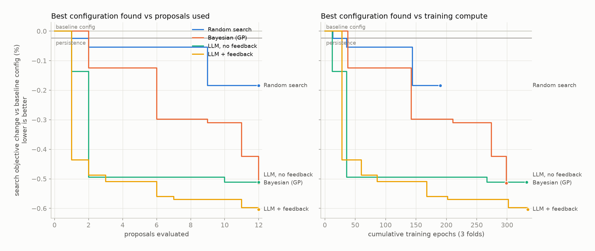
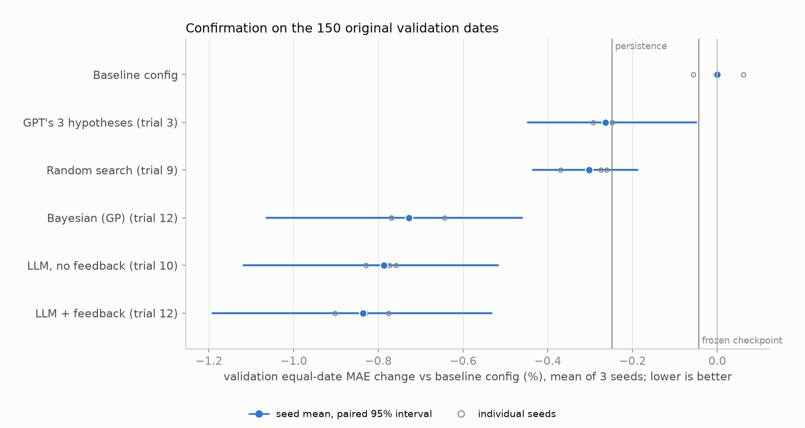
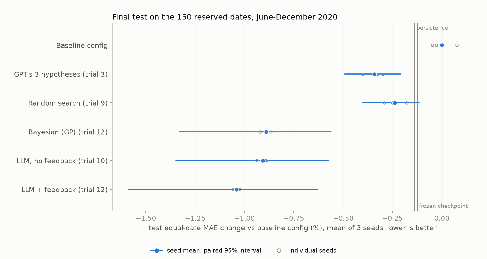

# Can an LLM Improve a Forecasting Model Faster Than Conventional Tuning?

Next-minute return forecasting for Nifty index options, from data audit to a blinded LLM-guided improvement experiment · Fall 2026 AI Financial Models · project summary, November 2026

<!-- toc -->

## Abstract

We asked whether a large language model (LLM), acting as an offline research assistant that reads model diagnostics, can find improvements to a forecasting model more efficiently than conventional hyperparameter tuning under the same experiment budget.

**Data and task.** We audited 17.6 million one-minute bars of Nifty index options (December 2016 to December 2020). The files lack contract identifiers, underlying prices and quotes, so we framed the task as forecasting the next-minute log return. Each prediction uses 15 features summarizing the previous six bars, and the data split chronologically into training, validation and test dates.

**Baselines.** Ridge regression and eight MLP architectures all failed to beat persistence (predicting no price change) on the primary metric, equal-date mean absolute error (MAE). The frozen compact MLP was 0.21% worse than persistence on MAE but 5.1% better on RMSE.

**Experiment.** Five search methods then tuned the same frozen network under a predeclared protocol, each with 12 proposals over one eight-parameter space:
- random search
- Gaussian-process Bayesian optimization
- an LLM proposing all 12 configurations at once from a diagnostic brief
- an LLM proposing one at a time with measured feedback
- three hypotheses from our initial planning notes (3 proposals)

**Results.** Both LLM searches reached strong configurations within two proposals; Bayesian optimization needed all twelve. The feedback search's selection was the best on the later validation dates (0.59% below persistence) and on the reserved test dates (0.90% below persistence). On test it finished ahead of the no-feedback LLM (0.77%) and Bayesian optimization (0.75%). The improvement itself, which aligns the training loss and weighting with the evaluation metric, was also found by Bayesian optimization. Because each method ran only one search, the evidence supports faster discovery by the LLM, not a generally superior optimizer.

## 1. Motivation and research question

LLMs are increasingly proposed as research assistants for quantitative modelling. Published systems use them to propose Bayesian-optimization candidates (LLAMBO, ICLR 2024), engineer features for tabular models (CAAFE, NeurIPS 2023), iterate on factor and model research for equity markets (R&D-Agent(Q), 2025), and propose model stress tests (context-aware testing, NeurIPS 2024). These results motivate the idea but do not show it works for a given task. Gains reported on other datasets need not transfer, and an LLM that "improves a model" after many tries may simply be doing expensive random search.

We therefore set up a controlled comparison:

> **Research question.** Can an LLM use model diagnostics to find improvements more efficiently than conventional tuning, under the same experiment budget?

In this design the LLM never predicts prices. It proposes training and calibration settings for a small, fast numerical model. Python validates each proposal, trains the model and computes every reported number, so the deployed predictor remains the same inexpensive network. We study two LLM roles: proposing a batch from a written diagnostic brief, and refining proposals from measured results. Fine-tuning the LLM itself was out of scope; there were far too few research trajectories to train it.

The project began with a broader goal of neural option pricing with LLM-assisted validation. The data audit (Section 2) showed that the available files cannot support theoretical pricing, which led to the empirical forecasting task used throughout.

## 2. Data audit

The raw data are one-minute open, high, low, close and volume bars for Nifty index options, delivered as monthly archives. We audited every file before modelling.

- **Duplicate representations.** 5,682 physical files contained 2,545 CSV/TXT pairs with byte-identical content. Selecting one file per unique SHA-256 hash left **3,137 files and 17,611,169 rows**, from 2016-12-14 to 2020-12-31 across 1,004 observed dates. No raw file was altered.
- **Schema.** The files have no headers and carry 8 or 9 fields. The ninth field, present in 2.6 million rows, resembles open interest but is unverified, so it was never used. Option symbols appear in three formats (`CE 8700`, `NIFTY10000PE` and `NIFTY25JUN209800CE`). Parsing must handle the embedded date token, otherwise its digits are misread as a strike.
- **Quality.** No essential field was missing or non-numeric. We flagged, rather than silently deleted, the following:
  - 2,952 bars with inconsistent OHLC values
  - 34,662 bars outside the 09:15–15:29 session
  - 24,493 weekend observations, including the Saturday 2020-02-01 budget-day session that the exchange actually held
  - 396,423 zero-volume bars and 3.35 million flat bars
  - 491,095 bars priced at or below one
- **Coverage.** Contract coverage changes over time, and minute coverage is far from a complete grid: a source file observes a median of 219 of the 375 session minutes on a day it trades.



**Implication.** The files provide no verified contract master or expiry mapping, no synchronized underlying price and no bid/ask quotes. Without them, implied volatility, Greeks and Black–Scholes pricing errors cannot be computed reliably. We therefore forecast the observed bar price empirically and make no claim about pricing theory or trading profitability.

## 3. Forecasting task and dataset

**Target.** The target is the next-minute log return, `y = ln(close[t+1] / close[t])`, predicted after bar t is complete. Each example needs six consecutive observed bars of one option within one date, plus the next bar exactly one minute later. The predicted next price is `close[t] × exp(predicted y)`.

**Cleaning.** Cleaning removed 2,952 inconsistent bars and 31,989 out-of-session bars and kept every other valid observation, including zero-volume, flat and low-price bars. That left 17,576,228 bars and **11,469,619 supervised examples**. No gaps were filled.

**Features.** There are 15 inputs. The 9 continuous ones are:
- log close, log strike, log volume and log mean volume over six bars
- log high/low range and log close/open
- one-minute return, five-minute return and the standard deviation of the last five one-minute returns

These are standardized with training statistics only. The other six are cyclic time of day (sine and cosine), a call indicator, and flags for zero volume, close ≤ 1 and flat bars.

| Split | Dates | Period | Examples | Role |
|---|---|---|---|---|
| Training | 700 | 2016-12-14 to 2019-10-17 | 7,069,922 | fitting; all search folds lie inside it |
| Validation | 150 | 2019-10-18 to 2020-05-29 | 2,009,818 | architecture selection, then confirmation |
| Test | 150 | 2020-06-01 to 2020-12-31 | 2,389,879 | reserved; evaluated once at the end |

The split is chronological by date (70/15/15), and every file on a date shares that date's split. Because windows on the same date share market conditions, millions of rows are not millions of independent observations. Every uncertainty estimate below therefore resamples dates, not rows.

**Metric.** The primary metric is **equal-date MAE**: the mean absolute log-return error on each date, averaged over dates so that each date counts equally regardless of how many options traded. Pooled MAE and RMSE, reconstructed-price MAE and RMSE, and subgroup errors are secondary. The reference forecast is **persistence**: predict zero return, i.e. an unchanged next price.

**Target distribution.** The target is unusual. In the training split:
- 12.7% of targets are exactly zero.
- The median absolute return is about 0.09 standard deviations.
- Rare low-price options produce returns as large as 93 standard deviations.

This mix of many tiny values and extreme tails turns out to matter (Section 5).

## 4. Baseline models and architecture selection

**Models.** We first fixed three kinds of reference model: persistence, ridge regression with three penalties, and small multilayer perceptrons (MLPs) that consume the 15 features.

**Training protocol.** All MLPs used the same recipe:
- Smooth L1 loss (β = 1) on the target divided by its training standard deviation
- AdamW with learning rate 0.001 and weight decay 0.0001, batch size 4,096
- at most 12 epochs, with early stopping and learning-rate reduction on validation equal-date MAE
- gradient clipping, and an output layer initialized at zero so training starts from persistence

Each architecture was trained with seeds 17, 42 and 2026.

**Ridge** improved RMSE slightly but was clearly worse than persistence on equal-date MAE (0.01559 at best, against 0.01490). An architecture study then compared **eight MLP families × three seeds**, covering compact, standard, wide, shallow, deep, BatchNorm and residual/LayerNorm designs.

| MLP | Structure | Parameters | Mean equal-date MAE |
|---|---|---|---|
| Wide / tapered | 15→128→64→32→1 | 12,417 | 0.0149090 |
| Deep | 15→64→64→64→64→1 | 13,569 | 0.0149135 |
| Standard + dropout | 15→64→32→1 | 3,137 | 0.0149213 |
| BatchNorm | 15→64→32→1 | 3,329 | 0.0149248 |
| **Compact (selected)** | 15→32→16→1 | 1,057 | 0.0149302 |
| Residual + LayerNorm | 15→64, 2 residual blocks | 17,985 | 0.0149363 |
| Standard, no dropout | 15→64→32→1 | 3,137 | 0.0149675 |
| Shallow | 15→64→1 | 1,089 | 0.0151381 |
| *Persistence* | – | 0 | *0.0148986* |

**No MLP beat persistence** on equal-date MAE. Extra capacity bought very little: the best architecture (wide) was only 0.14% better than the compact one. A predeclared rule chose the smallest architecture within 0.5% of the best mean: the compact `15→32→16→1` network. Its seed-42 checkpoint was frozen as the reference model, and it runs in about 49 µs per example on a CPU.



## 5. Diagnosis: why the baseline lost to persistence

Against persistence on the validation dates, the frozen compact MLP was:

| Metric | Change vs persistence |
|---|---|
| Equal-date MAE | **+0.21%** (worse) |
| Pooled MAE | +0.30% (worse) |
| Pooled RMSE | **−5.06%** (better) |
| Price MAE | +0.63% (worse) |
| Price RMSE | +1.19% (worse) |

It beat persistence on only 41 of 150 dates. The improvement in squared error was extremely concentrated: options priced at or below one were 2.29% of rows but supplied **99.25%** of the reduction in squared error.



**The loss and the metric disagree.** Smooth L1 with β = 1 on standardized targets is quadratic whenever the error is below one standard deviation. With predictions near zero, that holds for about 98% of training rows. So the network was effectively trained with squared error and learned something close to the **conditional mean**. Equal-date MAE, however, is minimized by the **conditional median**, and with 12.7% zero targets and heavy tails the two differ.

The same mismatch appears in the weighting. Training weights every row equally, while the metric weights every *date* equally.

The diagnosis predicts the observed pattern: better RMSE, especially where returns are extreme, but slightly worse typical errors. We did not give this diagnosis to the LLM. Its brief contained only facts: the target distribution, the baseline's fold-by-fold diagnostics and earlier findings. Section 7 shows what each search method made of the same opportunity.

## 6. The LLM-guided improvement experiment

### 6.1 Design

The experiment compares five ways to tune the unchanged compact network. Every search proposes complete settings from the same eight-parameter space and has a budget of 12 proposals (3 for the planning-note arm). Invalid proposals and duplicates count against the budget.

| Search | How proposals are made | Question it answers |
|---|---|---|
| Random search | Uniform sampling of the space | How far does undirected trial and error go? |
| Bayesian optimization | Optuna Gaussian-process sampler; 3 random starts, then model-guided | How far does conventional tuning go? |
| LLM, no feedback | Reads the diagnostic brief once and proposes all 12 configurations | Are diagnostics plus general knowledge enough? |
| LLM + feedback | Proposes one configuration at a time after reading every earlier measured result | Does interpreting results add value? |
| Planning-note hypotheses | Three single changes proposed before the experiment: date weighting, one shrinkage factor, per-price-group shrinkage | Were the initial expert-style ideas right? |

| Parameter | Allowed values | Baseline |
|---|---|---|
| Loss | Smooth L1, L1, MSE | Smooth L1 |
| Smooth L1 β (scaled units) | 0.01–10 | 1 |
| Learning rate | 0.0001–0.01 | 0.001 |
| Weight decay | 0.000001–0.1 | 0.0001 |
| Dropout | 0–0.5 | 0.1 |
| Sample weighting | none, date-balanced | none |
| Weight of rows priced ≤ 1 | 0.01–1 | 1 |
| Output calibration | none, one factor α, separate α for price ≤ 1 and > 1 | none |

Architecture, features, batch size and the epoch budget are fixed. The calibration factor α lies in [0, 1] and is fitted on tuning dates to minimize equal-date MAE (α = 0 reproduces persistence).

### 6.2 Evaluation without peeking

Every proposal is trained on **three expanding forward folds inside the training dates**. Each fold has three windows:
- **fit dates**, which train the network
- the next 40 **tune dates**, which drive early stopping, learning-rate reduction and calibration
- the next 80 **score dates**, which produce the reported metrics

Features and the target are re-standardized on each fold's fit dates, so no fold uses information from its future. The search objective is the mean score-window equal-date MAE across folds.

{width=80%}

**Confirmation.** After all searches finished, each search's best configuration was refit with three seeds on dates through August 2019, tuned on the last 40 training dates, and scored on the 150 validation dates. Comparisons with the baseline configuration (refit identically) use a paired circular block bootstrap over dates: 5-date blocks, 2,000 resamples.

**Final test.** Finally, the frozen selections were refit once more and scored once on the reserved June–December 2020 dates. That refit used dates 0–809 for fitting and dates 810–849 for tuning.

### 6.3 Safeguards

- **Exact replication first.** The new training code reproduced the original frozen checkpoint's weights and validation predictions bit for bit, so differences between configurations cannot come from a rewritten training loop.
- **Rules fixed in advance.** The protocol was written before any search training: budgets, folds, seeds, selection rule, analysis plan and known caveats. The hashes of every result-affecting source file were recorded, and the runner refuses to continue if any of them changes.
- **The test set stayed sealed.** Test arrays were opened only by the final, run-once evaluation. No prompt contained test-period information.
- **Python computes every number.** LLM text cannot supply labels or metrics. Every proposal is validated against a strict schema with field-level error messages, and unusable replies get exactly one repair round.

### 6.4 How the LLM was used

**What the LLM saw.** Both LLM arms received the same written brief, about 8,800 characters:
- the task and feature definitions
- the fixed parts of the model
- the objective and fold windows
- the search space
- the target distribution in the earliest fit window
- the baseline's fold-level diagnostics: per-fold changes, subgroup errors, learning curves and prediction-size statistics
- earlier validation findings

**What each proposal contained.** Each proposal was a JSON object with a hypothesis, the change made, a numerical predicted effect, the expected diagnostic effect, a rejection criterion and the full configuration. In the feedback arm every new prompt appended all earlier results, so the prompt grew from 8.8k to 57k characters.

**Who answered.** The pilot had no API connection. Each prompt was answered by a **fresh Claude Opus 5.5 subagent** that was told to read only its prompt file and write only its reply; no subagent saw earlier conversations or the orchestrating session's context. One subagent (feedback step 12) read its prompt twice because the first read was truncated. A transcript check confirmed that every subagent saw its complete prompt, and every reply was submitted unedited.

## 7. Results

### 7.1 Search efficiency

| Search | Best search change | Mean best-so-far | First proposal at ≤ −0.45% | Training epochs |
|---|---|---|---|---|
| LLM + feedback | −0.603% | −0.541% | 2 | 334 |
| LLM, no feedback | −0.512% | −0.469% | 2 | 332 |
| Bayesian optimization | −0.514% | −0.246% | 12 | 299 |
| Random search | −0.184% | −0.095% | never | 190 |
| Planning-note hypotheses | −0.136% | −0.054% | never | 41 |

Changes are relative to the baseline configuration on the search folds, where it scored 0.0144484 against 0.0144451 for persistence. *Mean best-so-far* averages, over the 12 proposals, the best result found so far, so it rewards early discovery. Both LLM searches reached about −0.5% by their **second** proposal. Bayesian optimization reached the same level only with its **twelfth**, and was still improving when its budget ran out. Random search never found the L1 loss in its 12 draws.



### 7.2 Confirmation on the validation dates

| Selection | Equal-date MAE (3 seeds) | vs baseline config [paired 95%] | vs persistence | Dates better than persistence | Price MAE vs persistence |
|---|---|---|---|---|---|
| **LLM + feedback** | 0.0148108 | **−0.836%** [−1.192, −0.533] | **−0.589%** | 111/150 | −0.15% |
| LLM, no feedback | 0.0148182 | −0.787% [−1.118, −0.517] | −0.539% | 106/150 | +0.31% |
| Bayesian optimization | 0.0148271 | −0.728% [−1.064, −0.460] | −0.480% | 101/150 | +0.60% |
| Random search | 0.0148906 | −0.302% [−0.435, −0.189] | −0.053% | 69/150 | +0.30% |
| Planning-note hypothesis 3 | 0.0148964 | −0.264% [−0.447, −0.050] | −0.015% | 19/150 | +0.00% |
| Baseline configuration | 0.0149357 | – | +0.249% | 32/150 | +0.54% |

Persistence scored 0.0148986 on these dates. The search ranking carried over to dates that no search had seen:
- Every selection beat the baseline configuration; all intervals exclude zero.
- The three L1-based selections beat persistence on two-thirds or more of dates.
- No earlier model in this project had beaten persistence on this metric.
- The feedback selection is the only one that also lowered the reconstructed-price MAE.

In an exploratory paired comparison, the feedback selection beat Bayesian optimization's by 0.11% [0.02, 0.21]. That advantage came from fewer, larger daily wins: it was better on only 52 of 150 dates.



### 7.3 Final test on the reserved dates

The test plan was:
1. After every selection was frozen, refit the six selections once more under the predeclared test plan: fit on dates through 2020-03-26, tune on 2020-03-27 to 2020-05-29.
2. Score them once on the 150 reserved dates, 2020-06-01 to 2020-12-31.

| Selection | Test equal-date MAE (3 seeds) | vs baseline config [paired 95%] | vs persistence | Dates better than persistence | Price MAE vs persistence |
|---|---|---|---|---|---|
| **LLM + feedback** | 0.0131588 | **−1.040%** [−1.586, −0.628] | **−0.904%** | 102/150 | −0.14% |
| LLM, no feedback | 0.0131766 | −0.907% [−1.347, −0.575] | −0.770% | 106/150 | −0.16% |
| Bayesian optimization | 0.0131788 | −0.890% [−1.329, −0.561] | −0.754% | 102/150 | −0.14% |
| Planning-note hypothesis 3 | 0.0132516 | −0.343% [−0.493, −0.208] | −0.205% | 19/150 | +0.00% |
| Random search | 0.0132653 | −0.240% [−0.403, −0.116] | −0.102% | 52/150 | −0.05% |
| Baseline configuration | 0.0132972 | – | +0.138% | 41/150 | +0.05% |

**Reference scores.** Persistence scored 0.0132788. The unchanged frozen checkpoint scored 0.0132805 (+0.01%), but it was trained only on data before October 2019, so the refit baseline configuration is the like-for-like comparator.

**The test confirms the validation picture.**
- The same three selections lead, in the same order.
- Their margins over persistence are larger: 0.75–0.90%.
- All three now slightly improve reconstructed-price MAE.

**Exploratory paired comparisons.** The feedback selection beat Bayesian optimization's by 0.15% [0.06, 0.27], on 90 of 150 dates, and the no-feedback selection's by 0.14% [0.05, 0.25]. The no-feedback selection's edge over Bayesian optimization was negligible (0.02%).



### 7.4 What the searches found

**The shared recipe.** The three strong configurations share the same core: **L1 loss, date-balanced weighting and no dropout**. These are exactly the changes that align training with the metric, as the diagnosis in Section 5 predicts:
- L1 targets the conditional median.
- Date-balanced weighting gives each date equal influence.

**Refinement by the feedback search.** It then tuned the learning rate by bracketing: 0.001, then 0.0005 (worse), 0.002 and 0.004 (better), 0.008 (much worse), and finally 0.003 (best). Calibration changed the objective by at most about 0.05 percentage points once the loss was L1; fitted factors stayed between 0.85 and 1.0. Weight decay of 0.1 helped slightly at a learning rate of 0.001 but hurt at 0.004.

**The planning-note hypotheses.** These focused on shrinking predictions toward persistence and turned out to be the weakest arm:
- Date weighting alone had no effect.
- One global factor was unstable across folds.
- Per-price-group factors helped on the search folds but collapsed to persistence on validation; their fitted factors were zero in most seeds.

## 8. How the LLM behaved, and what it cost

**Validity.** All 24 LLM proposals were valid on the first attempt. No repair round was needed, and neither arm repeated a configuration. The no-feedback LLM's first, most cautious proposal was identical to planning-note hypothesis 3. Its second proposal already combined L1 loss, date weighting and no dropout.

**Method.** The feedback LLM behaved like a careful researcher. It changed one or two settings at a time from the best configuration so far, reverted changes that hurt, and cited specific diagnostics: late-epoch learning curves, fold-level changes, and gains concentrated in low-priced options.

**Predictions.** Its predicted effects ranked the measured effects moderately well (Spearman correlation 0.41; 0.61 for the batch arm), and were sometimes very close: −0.57% predicted against −0.570% measured. It was also sometimes overconfident: −0.58% predicted against −0.26% measured when it doubled the learning rate to 0.008.

**Cost.** LLM reasoning was the expensive part.

| Search | LLM runs | Tokens | LLM time |
|---|---|---|---|
| LLM + feedback | 12 | about 1.26 million | 111 min |
| LLM, no feedback | 1 | 0.11 million | 12 min |
| Bayesian optimization | – | – | seconds of proposal overhead |

Training compute was similar across the strong searches: 332–334 epochs for the LLM searches against 299 for Bayesian optimization. L1 configurations train longer before early stopping.

## 9. Discussion

**Answering the question.** In this pilot, yes, in a specific sense. The LLM used the diagnostics to reach strong configurations after two proposals instead of twelve. The feedback search ended with the best selection on both held-out periods: 0.59% below persistence on validation dates and 0.90% on test dates. Its advantage over Bayesian optimization at the end of the budget was small, though: 0.06–0.11% on validation and 0.15% on test, comparable to training-seed variation.

**What the evidence does not show.** Bayesian optimization found the key change without any diagnostics, and each method ran only one search. So the evidence supports *faster discovery*, not discovery that conventional tuning cannot make, and not a generally better optimizer.

**What made the difference.** The decisive information was in the diagnostic brief, not only in iterative feedback. The batch LLM, which never saw a single result, captured most of the gain by reading the target distribution and the baseline diagnostics. Feedback then added refinement, mainly the learning rate, worth roughly 0.05–0.1%. The planning-note hypotheses focused on calibration and missed the larger lever: changing what the model is trained to minimize.

**Practical value.** The trade-off depends on what an experiment costs.
- **Cheap experiments.** Here each experiment took about 1–4 minutes of CPU training. A conventional optimizer with a somewhat larger budget would probably have matched the LLM at lower cost than 1.26 million tokens.
- **Expensive experiments.** When each experiment takes hours, a two-proposal route to the right region is worth far more.
- **Interpretability.** Every LLM proposal came with a stated hypothesis and a rejection criterion, which makes the search history an interpretable research log. That is useful for review and for transferring insight to the next problem.

**Forecasting value.** The best configuration beats persistence in equal-date MAE by about 0.6% on validation dates and 0.9% on test dates, beats it on about two-thirds or more of days, and slightly improves reconstructed-price MAE. The gain is small in absolute terms. L1 training also gives up part of the original RMSE advantage: −3.4% against −5.7% for the baseline configuration on validation, and −4.4% against −7.2% on test. None of this is a trading result: the data contain no executable quotes or transaction costs.

## 10. Limitations

- **One search per method.** The pilot cannot separate the quality of a method from the luck of one search.
- **Single training seed during search.** Seed variation in validation equal-date MAE (0.03–0.07%) is comparable to the gaps between the top three methods.
- **Reused validation dates.** The validation dates were used for architecture selection, and the LLM brief summarized earlier findings from them. Confirmation there is a development estimate; the test dates provide the untouched estimate.
- **The LLM setup.** The LLM was Claude Opus 5.5 running as a Claude Code subagent with tool access it was instructed not to use. Compliance was self-reported, though transcripts confirmed that each subagent saw its complete prompt.
- **Task-specific results.** Results are specific to this eight-parameter space. L1 loss was one of three loss options, so any method could reach it.
- **Concurrency.** Some searches ran concurrently, so wall-clock training times are not comparable; epochs are the fair cost unit.
- **Non-stationarity.** The test period (June–December 2020) follows the March 2020 volatility spike. Conclusions may not hold in other market regimes.

## 11. Future work

1. **Repeat each search** at least twice more with new seeds and fresh LLM conversations. This turns the pilot into a method-level comparison with search-to-search uncertainty.
2. **Run a score-only feedback arm,** whose prompts contain objectives but no diagnostics, to isolate the value of diagnostics.
3. **Give Bayesian optimization a larger budget,** which shows how many extra experiments the LLM's head start is worth.
4. **Extend the LLM's role** to feature engineering (causal formulas over prices, volumes and returns) and to failure discovery and monitoring. The latter would turn the LLM's hypotheses into recurring stress tests on verified historical subsets.
5. **Obtain a contract master, expiries and synchronized underlying prices.** With them, theoretical pricing models and pricing-error diagnostics become possible.

## 12. Reproducibility

Every stage is scripted and records its inputs' hashes; the reports directory holds the small tables, protocols and verification records. The main commands are:

```bash
conda env create --prefix ./.conda --file environment.yml && conda activate ./.conda
python scripts/nifty_eda.py --refresh-inventory            # data audit
python scripts/nifty_preprocess.py                         # supervised dataset
python scripts/train_nifty_models.py                       # baselines and frozen MLP
python scripts/train_nifty_mlp_study.py                    # architecture study
python scripts/run_nifty_llm_search.py --init              # protocol, replication, baseline
python scripts/run_nifty_llm_search.py --arm bayes         # one arm at a time; the others are random,
                                                           # gpt_hypotheses, llm_batch and llm_feedback
python scripts/confirm_nifty_llm_search.py                 # validation confirmation
python scripts/confirm_nifty_llm_search.py --final-test    # run-once test evaluation
python scripts/build_nifty_llm_search_report.py && python scripts/build_project_summary.py
```

Key records:
- [study protocol](../nifty_llm_search/protocol.json)
- [the exact brief given to the LLM](../nifty_llm_search/brief.md)
- [every prompt and reply](../nifty_llm_search/handoff)
- [how prompts were answered](../nifty_llm_search/llm_relay.md)
- [LLM search report](../nifty_llm_search/report.md) and [findings](../nifty_llm_search/findings.md)
- [baseline performance report](../nifty_baseline_performance/report.md)
- [architecture study](../nifty_mlp_study/report.md)
- the EDA, preprocessing and baseline notebooks in [notebooks](../../notebooks)
